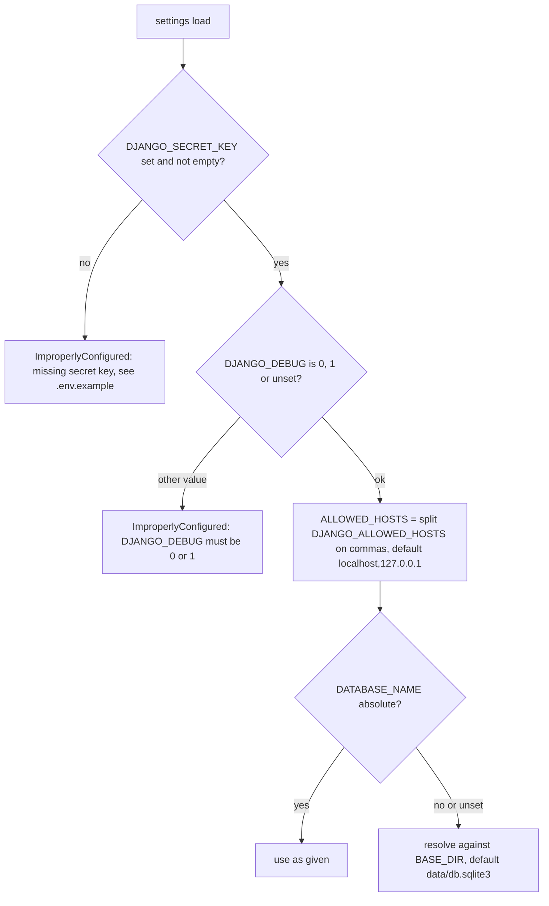

# Project Django Setup - Plan

## Goal Capsule

- **Objective:** A contributor can clone the repository, follow the README, and reach a running Knot Calendar development server, with linting and tests passing locally. The CI pipeline and the health check probes then build on this base.
- **Means:** Django 6.1 on Python 3.14, managed with uv, configured only through environment variables, with SQLite as the database (KTD1, KTD2, KTD3).
- **Authority:** the user, then `AGENTS.md`, then issue #3's acceptance criteria, then this plan. If this plan disagrees with the issue, the issue wins and this plan gets fixed.
- **Execution profile:** the user implements each unit by hand. The assistant explains, reviews the diff, and runs the unit's checks when asked, and writes code only when the user asks it to. Each unit is sized to be one commit, except U2 and U3, which share one commit so the generated secret key never reaches the branch.
- **Stop conditions:** stop and ask the user before continuing if any of these happen:
  - pytest-django fails against Django 6.1.
  - A unit seems to need a third-party configuration library or a Postgres driver.
  - A unit seems to need a change outside the files listed in this plan.
- **Who finishes:** the user opens the PR from `chore/3-project-django-setup`, closing #3. Approval and squash merge follow `AGENTS.md`.

---

## Product Contract

### Summary

Create the Django project skeleton for Knot Calendar: a uv-managed Python 3.14 project, settings driven by environment variables, a SQLite database under `data/`, Ruff and Pytest with a single smoke test, local pre-commit hooks, and a README that takes a newcomer from `git clone` to `runserver`.

### Problem Frame

The repository has only documentation and GitHub metadata, with no code and no chosen stack. The user decided to build health check probes before any product feature. Those probes must be proven by tests and enforced by CI, so the test and lint tooling has to exist first. This scaffold is the first of three PRs (scaffold, CI, probes), and the later two plan against the files this one creates.

### Requirements

**Runtime and dependencies**

- R1. Python 3.14 is pinned in `.python-version` and in `requires-python = ">=3.14"` in `pyproject.toml`.
- R2. uv manages dependencies, and `uv.lock` is committed.
- R3. Django is pinned to `django~=6.1.3`.
- R4. The project package is `config/`, created by `startproject config .`, and holds settings, URLs, WSGI and ASGI.

**Configuration**

- R5. Settings read configuration with `os.environ` only, with no third-party configuration library.
- R6. `DJANGO_SECRET_KEY` is always required, with no development fallback. If it is missing or empty, startup stops with a clear error.
- R7. `DJANGO_DEBUG` accepts `0` or `1` and defaults to `0`. Any other value stops startup with a clear error.
- R8. `DJANGO_ALLOWED_HOSTS` is a comma-separated list that defaults to `localhost,127.0.0.1`.
- R9. The SQLite path comes from `DATABASE_NAME` and defaults to `data/db.sqlite3`.
- R10. `data/` stays in the repository through `data/.gitkeep`, and everything else in it is gitignored.
- R11. A committed `.env.example` lists every variable. The secret key is left empty, as a placeholder, next to the command that generates a real one. An unedited copy therefore fails the R6 check rather than starting the app on a publicly known key.
- R12. `.env` is gitignored.

**Tooling**

- R13. Ruff is configured in `pyproject.toml` with its default rules plus `I`, `UP`, `B` and `DJ`, and both `ruff check` and `ruff format --check` pass.
- R14. Pytest is configured with pytest-django, and the suite passes.
- R15. One smoke test runs `SELECT 1` on the configured database connection.
- R16. `pre-commit` is a uv-managed dev dependency whose local hooks run Ruff through `uv run`, so they use the Ruff version locked in `uv.lock`.

**Documentation**

- R17. The README has badges for License (AGPLv3), Python 3.14, Django 6.1 and Ruff.
- R18. The README "Getting started" section lists the prerequisites (Python 3.14, uv, git) and every step from `git clone` to `runserver`.
- R19. The README "Development" section lists the lint, format, test and `pre-commit install` commands.
- R20. Following the README exactly on a fresh clone leads to a running server.

### Key Decisions

- **SQLite only. Postgres waits until the app runs under Compose or Kubernetes.** (session-settled: user-directed — chosen over supporting SQLite and Postgres from day one via `DATABASE_URL`: Postgres is easier to run once there is container orchestration to start it.) Governs R5, R9.
- **The README is the single source for setup and development commands.** `AGENTS.md` will link to it when the CI PR updates its "Status" section. (session-settled: user-approved — chosen over writing the commands in both files: two copies drift apart.) Governs R17, R18, R19.

### Scope Boundaries

- Not built: automated tests for the configuration errors in R6 and R7. Issue #3 asks for one smoke test, so U3 checks these failures by hand. Add tests if a later change to settings breaks them unnoticed.
- Not built: a root URL or any view. There is nothing to show yet, and Django's default page is not worth testing.
- Not built: split settings modules (`base`/`dev`/`prod`). Environment variables already cover the differences between environments.
- Not built: email/mailer configuration. No `EMAIL_BACKEND` setting is added in this unit.
- Not built: `DEFAULT_AUTO_FIELD`. `startproject`'s default (`'django.db.models.BigAutoField'`) is deferred rather than added now, pending a future discussion on adopting UUID primary keys instead.

#### Deferred to Follow-Up Work

- The CI workflow, the CI badge, and making CI a required status check, in the next PR (`ci`). That PR also updates the `AGENTS.md` "Status" section.
- Liveness and readiness probes, in the PR after that (`feat`).
- Container packaging: the Dockerfile, the production server choice (Gunicorn or Uvicorn), static files, and Compose.
- Postgres, configured through more `DATABASE_`-prefixed variables, together with a Postgres job in CI.

### Sources

- Issue #3 acceptance criteria (the agreed spec): <https://github.com/MonkeEngineer/knot-calendar/issues/3>
- `AGENTS.md`: branch naming, Conventional Commits, one concern per PR, squash merge.

---

## Planning Contract

### Key Technical Decisions

- KTD1. **Pin `django~=6.1.3`.** 6.1.3 is the newest release on PyPI (checked 2026-11-27), and its classifiers list Python 3.14. The `~=` pin takes 6.1 patch releases and blocks 6.2, so moving to the 6.2 LTS is a deliberate change. (session-settled: user-approved — chosen over an open "6.0 or later" pin: the newest 6.x is supported the longest.)
- KTD2. **Read configuration with plain `os.environ`, and load `.env` through uv.** Local commands run as `uv run --env-file .env <cmd>`, or with `UV_ENV_FILE=.env` exported once in the shell. Nothing in Python reads `.env`. (session-settled: user-directed — chosen over `dj-database-url` or `django-environ`: with only SQLite, a library adds a dependency and saves nothing.)
- KTD3. **Name settings by area: `DJANGO_SECRET_KEY`, `DJANGO_DEBUG` and `DJANGO_ALLOWED_HOSTS` for Django, and `DATABASE_NAME` for the database.** (session-settled: user-directed — chosen over prefixing everything with `DJANGO_`: database settings get their own prefix, which later Postgres variables follow.)
- KTD4. **`DJANGO_DEBUG` is strict `0`/`1`, defaulting to `0`.** A value such as `True` stops startup rather than being read as off without anyone noticing. (session-settled: user-directed — chosen over accepting `True`/`False` strings; the strict rejection was user-approved.)
- KTD5. **`DJANGO_SECRET_KEY` has no fallback, even when debug is on.** Developers generate a key with `django.core.management.utils.get_random_secret_key` and put it in `.env`, starting from `.env.example`. The placeholder in `.env.example` is an empty value rather than a sample key, so an unedited copy fails the existing empty-value check (session-settled: user-approved — chosen over a `change-me` value with an extra check that rejects it: needs no extra code). (session-settled: user-directed — chosen over an insecure development key when debug is on: one rule for all environments.)
- KTD6. **Configuration errors raise `ImproperlyConfigured` while settings load.** The message names the variable and says how to fix it, for example by pointing at `.env.example`. Every `manage.py` command and the pytest run then fail early, with the same message.
- KTD7. **A relative `DATABASE_NAME` is resolved against the project's base directory, and an absolute one is used unchanged.** The default `data/db.sqlite3` then works no matter which directory a command runs from, and a container can later point it at a mounted volume. (session-settled: user-directed for the `data/` location — chosen over the repository root, which is harder to mount as a volume. The relative/absolute rule is a planning choice.)
- KTD8. **`data/` is kept with `data/.gitkeep`, and `.gitignore` ignores `data/*` except that file.** SQLite does not create missing directories, so without this a fresh clone fails on `migrate` with "unable to open database file". The current `.gitignore` already ignores `db.sqlite3` and `.env` (from GitHub's Python template). It does not ignore `.env.*`, so `.env.example` is committed without any exception.
- KTD9. **Use the layout from `startproject config .`, with tests in a top-level `tests/` directory.** No `src/` folder and no apps yet. The probes PR adds the first app. (session-settled: user-approved — chosen over a `src/` layout and split settings files: the simplest shape until there is code to organize.)
- KTD10. **Ruff selects the default rules plus `I`, `UP`, `B` and `DJ`, and its target version comes from `requires-python`.** Add more rules later as needed. (session-settled: user-approved — chosen over selecting `ALL`, which is too noisy for a new project.)
- KTD11. **Configure pytest in `pyproject.toml` under `[tool.pytest.ini_options]`, with `DJANGO_SETTINGS_MODULE = "config.settings"`.** pytest 9 also offers a native `[tool.pytest]` table, but pytest-django's documentation uses the ini-options form. Stay on the documented form until pytest-django documents the native table.
- KTD12. **The smoke test runs `SELECT 1` through Django's default database connection, marked `django_db`.** pytest-django runs it against the test copy of the configured database. For SQLite that copy is in memory, which still exercises the configured engine. The probes PR reuses the same backend-agnostic query for readiness. (session-settled: user-approved — chosen over testing the root page, which does not exist.)
- KTD13. **Pre-commit uses `repo: local` hooks that run `uv run ruff check --fix` and `uv run ruff format` on Python files, with `language: unsupported`.** pre-commit 4.x added `unsupported` as the new name for `system`, which will be deprecated. (session-settled: user-approved — chosen over the `ruff-pre-commit` mirror, whose own pinned Ruff version can drift from `uv.lock`.)

### High-Level Technical Design

How settings resolve configuration when they load (U3). The prose in KTD4–KTD7 is authoritative. The diagram shows the order of the checks.



### Output Structure

```text
.
├── .env.example
├── .gitignore              (modified: data/* rules)
├── .pre-commit-config.yaml
├── .python-version
├── README.md               (modified)
├── config/
│   ├── __init__.py
│   ├── asgi.py
│   ├── settings.py
│   ├── urls.py
│   └── wsgi.py
├── data/
│   └── .gitkeep
├── docs/
│   └── plans/
│       └── 2026-11-27-001-chore-project-django-setup-plan.md
├── manage.py
├── pyproject.toml
├── tests/
│   ├── __init__.py
│   └── test_smoke.py
└── uv.lock
```

### Risks & Dependencies

| Risk | Mitigation |
| --- | --- |
| pytest-django 4.14.0, the latest release, lists Django 5.2 and 6.0 in its classifiers but not 6.1. | U5's test run is the check. If it fails because of Django 6.1, stop (Goal Capsule) and look at pytest-django's issue tracker before trying a workaround. |
| The secret key generated by `startproject` gets committed. | It starts with `django-insecure-` and is never used. Still, replace it in U3 before the first commit that includes `config/settings.py`. |
| A contributor forgets `--env-file .env` and gets an `ImproperlyConfigured` error. | This is intended (KTD5, KTD6). The message points at `.env.example`, and the README shows the `UV_ENV_FILE` shortcut. |

---

## Implementation Units

### U1. uv project on Python 3.14 with Django

- **Goal:** a uv-managed project that installs Django 6.1 on Python 3.14.
- **Requirements:** R1, R2, R3 (KTD1)
- **Dependencies:** none
- **Files:** `pyproject.toml`, `.python-version`, `uv.lock`
- **Approach:**
  1. Initialise a uv project in the existing repository root without creating sample code. Let uv write `.python-version` for 3.14.
  2. Set the project name, description and `requires-python`, and add the license field (AGPL-3.0-or-later, matching `LICENSE`).
  3. Add Django with the KTD1 pin.
- **Look up:** uv docs "Working on projects" (`uv init`, `uv add`), and `uv python pin`.
- **Test expectation:** none, because this unit is packaging only.
- **Verification:**
  - `uv run python --version` prints `Python 3.14.x`.
  - `uv run python -m django --version` prints `6.1.x`.
  - `uv.lock` exists and `git status` lists it as new.

### U2. Generate the Django project into `config/`

- **Goal:** a Django project skeleton whose package is `config/`.
- **Requirements:** R4 (KTD9)
- **Dependencies:** U1
- **Files:** `manage.py`, `config/__init__.py`, `config/settings.py`, `config/urls.py`, `config/asgi.py`, `config/wsgi.py`
- **Approach:** run `startproject` with the target directory `.`, so it does not create a nested folder. Leave the generated files alone, apart from the settings work in U3.
- **Look up:** Django 6.1 docs, `django-admin startproject` and its `directory` argument.
- **Execution note:** commit U2 together with U3, so the generated secret key never reaches the branch (see Risks).
- **Test expectation:** none, because this unit only generates the scaffold.
- **Verification:** `uv run python manage.py check` reports no issues while the generated settings are still unchanged.

### U3. Settings from environment variables, `data/`, and `.env.example`

- **Goal:** settings that take every deployment-specific value from the environment and fail early with a clear message when a value is missing or invalid.
- **Requirements:** R5–R12 (KTD2–KTD8)
- **Dependencies:** U2
- **Files:** `config/settings.py`, `.env.example`, `data/.gitkeep`, `.gitignore`
- **Approach:**
  1. In `config/settings.py`, replace the generated `SECRET_KEY`, `DEBUG`, `ALLOWED_HOSTS` and database `NAME` with values read from the environment, following the High-Level Technical Design flow.
  2. For `DJANGO_ALLOWED_HOSTS`, strip spaces around each entry and drop empty entries, so a trailing comma is harmless.
  3. Add `data/.gitkeep`, and add `.gitignore` rules that ignore `data/*` except `.gitkeep` (KTD8).
  4. Write `.env.example` with all four variables, each with a short comment:
     - `DJANGO_SECRET_KEY=''` is left empty, with the one-line command to generate a key and a note that the key goes inside the single quotes.
     - `DJANGO_DEBUG=1` is set for local development. Its comment says that the default in settings is `0`.

     The single quotes matter. uv expands `$` in unquoted `.env` values, and Django's generated keys can contain `$`, so an unquoted key is silently shortened.
- **Look up:** Django docs "Settings" (`ImproperlyConfigured`), the `SECRET_KEY`, `DEBUG`, `ALLOWED_HOSTS` and `DATABASES` reference entries, and uv's "Environment variables" page (`--env-file`, `UV_ENV_FILE`).
- **Test expectation:** none automated (see Scope Boundaries). The manual checks below cover every branch of the flow.
- **Verification:** first, an unedited copy of `.env.example` used as `.env` makes `check` fail, and the message names `DJANGO_SECRET_KEY`. Then, with a real key in `.env`:
  - `uv run --no-env-file python manage.py check` fails, and the message names `DJANGO_SECRET_KEY`. `--no-env-file` keeps this check valid even when `UV_ENV_FILE` is exported.
  - A key containing `$`, pasted inside single quotes, reaches Django unchanged. Check it by printing the length of `settings.SECRET_KEY` from `manage.py shell`.
  - `uv run --env-file .env python manage.py check` passes.
  - `DJANGO_DEBUG=True uv run --env-file .env python manage.py check` fails, and the message names `DJANGO_DEBUG`.
  - `uv run --env-file .env python manage.py migrate` creates `data/db.sqlite3`.
  - `git status` does not list the database file or `.env`, and does list `.env.example` and `data/.gitkeep`.

### U4. Ruff lint and format

- **Goal:** one lint and format configuration that the whole repository passes.
- **Requirements:** R13 (KTD10)
- **Dependencies:** U3
- **Files:** `pyproject.toml`, plus any Python file that Ruff reformats or fixes
- **Approach:**
  1. Add Ruff as a dev dependency.
  2. Configure lint selection and formatting under `[tool.ruff]` per KTD10.
  3. Run the formatter and autofixes once over the generated code, and review what changed before committing.
- **Look up:** Ruff docs "Configuring Ruff" and "Rules" (the `I`, `UP`, `B` and `DJ` prefixes), and `extend-select` compared with `select`.
- **Test expectation:** none, because this unit only adds tool configuration.
- **Verification:** `uv run ruff check` and `uv run ruff format --check` both exit 0.

### U5. Pytest with pytest-django and the smoke test

- **Goal:** a test suite that runs under uv and proves the configured database answers a query.
- **Requirements:** R14, R15 (KTD11, KTD12)
- **Dependencies:** U3, U4
- **Files:** `pyproject.toml`, `tests/__init__.py`, `tests/test_smoke.py`
- **Approach:**
  1. Add pytest and pytest-django as dev dependencies.
  2. Point pytest-django at `config.settings` per KTD11.
  3. Write the smoke test per KTD12.
- **Look up:** pytest-django docs "Configuring Django settings" and "Database access" (`django_db`), and Django docs "Executing custom SQL directly" (`connection.cursor()`).
- **Test scenarios:**
  - With a valid `.env`, the test opens a cursor on the default connection, runs `SELECT 1`, and gets one row containing `1`.
- **Verification:**
  - `uv run --env-file .env pytest` reports 1 passed.
  - `uv run --no-env-file pytest` stops with the `DJANGO_SECRET_KEY` message rather than a confusing pytest error.
  - `uv run ruff check` still passes on the new test file.

### U6. Pre-commit with local Ruff hooks

- **Goal:** every commit runs the same Ruff version as CI, automatically.
- **Requirements:** R16 (KTD13)
- **Dependencies:** U4
- **Files:** `pyproject.toml`, `.pre-commit-config.yaml`
- **Approach:**
  1. Add pre-commit as a dev dependency.
  2. Define one `repo: local` block with two hooks, a lint hook with fixes and a format hook. Both run through `uv run` and are limited to Python files.
- **Look up:** pre-commit docs "Repository local hooks" and the `unsupported` language.
- **Test expectation:** none, because this unit is developer tooling.
- **Verification:**
  - `uv run pre-commit run --all-files` passes both hooks.
  - After `uv run pre-commit install`, committing a deliberately misformatted Python file is blocked, or the file is reformatted and the commit stops for re-staging.

### U7. README: badges, Getting started, Development

- **Goal:** a newcomer gets from `git clone` to a running server using only the README.
- **Requirements:** R17–R20
- **Dependencies:** U1–U6
- **Files:** `README.md`
- **Approach:**
  1. Add badges under the title (KTD1 for the Django version). Keep the existing description and License section.
  2. "Getting started" lists the prerequisites and these steps in order:
     - clone
     - copy `.env.example` to `.env`
     - generate the secret key and paste it inside the single quotes
     - `uv sync`
     - `migrate`
     - `runserver`
  3. Mention `UV_ENV_FILE=.env` as the shortcut for `--env-file .env` (KTD2).
  4. "Development" lists `ruff check`, `ruff format`, `pytest` and `pre-commit install`, in the same uv form as Getting started.
- **Look up:** shields.io static badges (license, Python, Django) and Ruff's official badge in its README.
- **Test expectation:** none automated. The fresh-clone walkthrough below is the test.
- **Verification:** push the branch, clone it into a temporary directory, and follow the README word for word. `runserver` starts, `http://127.0.0.1:8000/admin/login/` returns HTTP 200, and the Development commands all pass. The plan adds no root view; with `DJANGO_DEBUG=1` and the unmodified `startproject` URLconf, Django 6.1's own install-success page is served at `/` with HTTP 200 (a framework behavior since Django 5.1, not something this plan builds). Fix the README wherever it was unclear.

---

## Verification Contract

Run all commands from the repository root with a valid `.env`. These are the gates for the PR, as well as each unit's own checks.

| Gate | Command | Passes when |
| --- | --- | --- |
| Django checks | `uv run --env-file .env python manage.py check` | "System check identified no issues" |
| Migrations apply | `uv run --env-file .env python manage.py migrate` | exits 0 and `data/db.sqlite3` exists |
| Lint | `uv run ruff check` | exits 0 |
| Format | `uv run ruff format --check` | exits 0 |
| Tests | `uv run --env-file .env pytest` | 1 passed |
| Hooks | `uv run pre-commit run --all-files` | all hooks pass |
| Secret key required | `uv run --no-env-file python manage.py check` | fails, naming `DJANGO_SECRET_KEY` |
| Debug strict | `DJANGO_DEBUG=True uv run --env-file .env python manage.py check` | fails, naming `DJANGO_DEBUG` |
| README walkthrough | fresh clone, following the README | `/admin/login/` returns 200, Development commands pass |

---

## Definition of Done

- Every checkbox in issue #3 is satisfied, and every gate in the Verification Contract passes.
- `git status` on a clean checkout shows no untracked database, `.env`, `.venv` or cache files.
- The branch is `chore/3-project-django-setup`. The PR title follows Conventional Commits (`chore: ...`), the body uses the PR template and links #3, and this plan file is part of the PR.
- The diff contains no leftover experiments, commented-out code, or the generated `django-insecure-` key.
